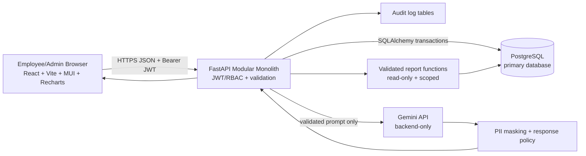
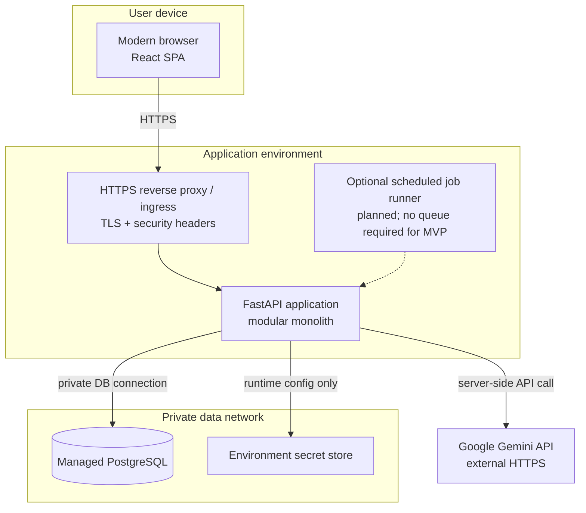
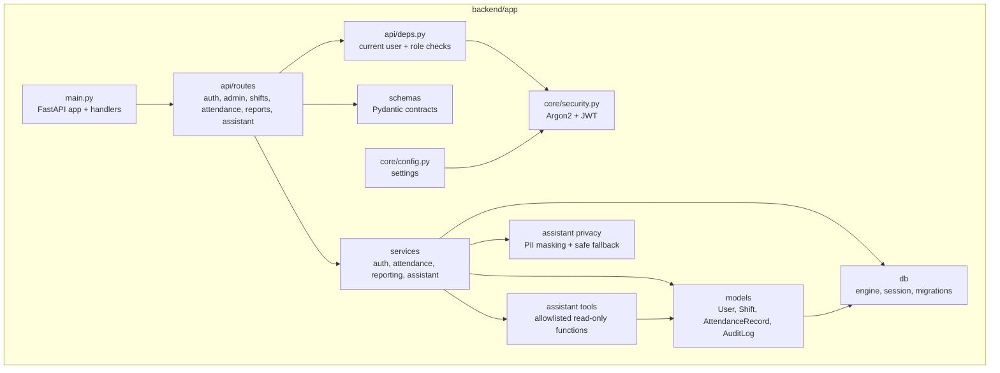
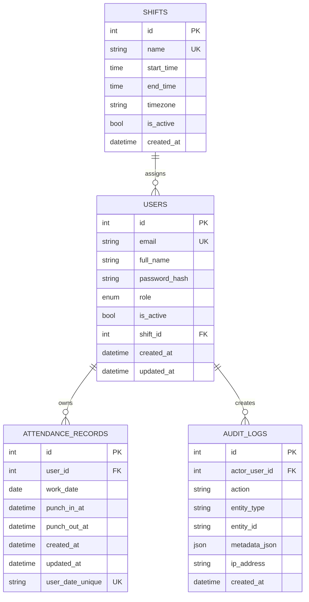
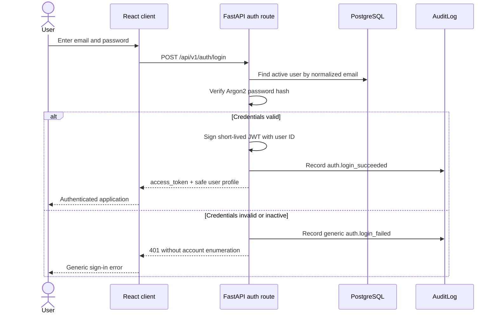
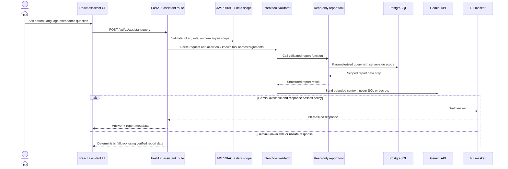

# Platform architecture diagrams

These diagrams describe the modular-monolith MVP boundary. Solid paths are part of the
current backend foundation or intended server flow; modules marked **planned** are not
claimed to be implemented until their stage is verified.

## High-level architecture



The browser never talks directly to PostgreSQL or Gemini. The API authenticates every
protected request, applies role and employee scope, and only then reads data or invokes a
validated read-only report tool.

## Deployment diagram



Production deployment must use a managed secret mechanism or equivalent environment
injection. Database and Gemini credentials are not bundled into the frontend artifact or
source control.

## Component diagram



The current implementation includes `auth`, admin employee/shift operations, employee
attendance punch/current/history operations, scoped reporting, `security`, settings,
database, models, health routes, and audit service. The assistant module is the next
isolated addition; it will not bypass route-level authorization or the service layer.

## Database ER diagram



`ATTENDANCE_RECORDS.user_id + work_date` is unique. `punch_out_at` cannot precede
`punch_in_at`. Shift timezone and work-date rules are deliberately represented in the
domain service rather than relying on database server timezone defaults.

## Authentication sequence



## Punch-in / punch-out sequence (implemented)

```mermaid
sequenceDiagram
    actor Employee
    participant UI as React client
    participant API as FastAPI attendance route
    participant Auth as JWT + employee scope
    participant DB as PostgreSQL transaction
    participant Audit as AuditLog

    Employee->>UI: Select Punch in or Punch out
    UI->>API: POST /api/v1/attendance/punch-in|punch-out
    API->>Auth: Validate token, active user, and employee scope
    Auth-->>API: Authorized employee identity
    API->>DB: Begin transaction; lock/find employee work-date row
    alt Punch-in and no existing punch-in
        API->>DB: Insert record with UTC timestamp
        DB-->>API: Commit
        API->>Audit: Record attendance.punch_in
        API-->>UI: Updated attendance state
    else Punch-out after valid punch-in and no punch-out
        API->>DB: Update row with UTC timestamp
        DB-->>API: Commit
        API->>Audit: Record attendance.punch_out
        API-->>UI: Updated attendance state
    else Duplicate or invalid transition
        API-->>UI: 409/422 structured error; no data mutation
    end
```

The service and database constraint both protect against duplicate actions. A client-side
button state is not an authorization or integrity control.

## AI attendance query sequence (planned)



The model cannot execute arbitrary SQL. If a tool name or argument is not allowlisted,
the API rejects it. Authorization and employee scoping happen before any report result is
returned, and logs/responses must mask applicable PII.
